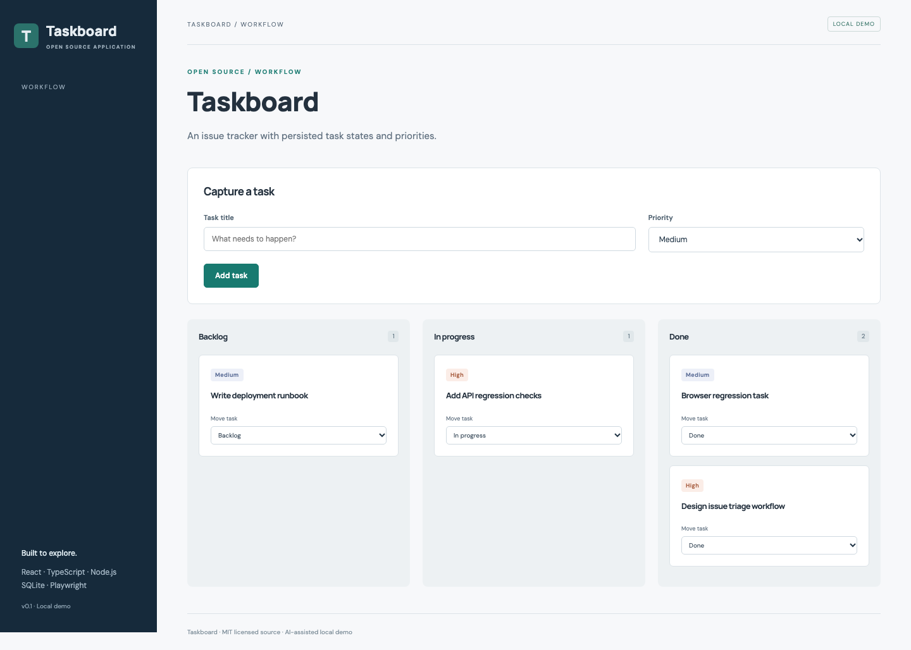

# Taskboard

Issue tracking and workflow. An independently runnable open source application.

## Run and demonstrate

From this repository, run `npm ci` and `npm run dev`. Open http://127.0.0.1:5173/#tasks.

Create a task with a priority, move it from Backlog to In progress to Done, then reload the page to verify persistence.

## Implementation and decisions

Task states are validated against a fixed enum. Invalid transitions to unknown states are rejected. Titles are stored with SQL parameters and rendered as text.

API implementation: [`server/projects/tasks.ts`](server/projects/tasks.ts). The React workflow is in [`src/main.tsx`](src/main.tsx); storage initialization and shared middleware are in [`server/app.ts`](server/app.ts).

## API

- `GET /api/tasks` — list tasks.
- `POST /api/tasks` — create `{title, priority}`; priority is Low, Medium, or High.
- `PATCH /api/tasks/:id` — change `{status}` to Backlog, In progress, or Done.

## Verification

Run `npm test` for domain/API checks. Run `npm run build`, then `npm run test:e2e` for browser flows, including **Taskboard adds a task and persists a status change**.

## Application description

> Taskboard: a React and TypeScript issue tracker with a Node.js API, validated task states, priority controls, SQLite persistence, and API/browser regression tests.

Use this as a description of the current project. Add your own reviewed contribution and disclose AI assistance when discussing development. Do not attach invented employment dates, client claims, production usage, or years of experience.

## Next contribution

Add a filtered task view and test that priority and status filters compose correctly.

MIT licensed. Initial implementation created with AI assistance in October 2026; see [CONTRIBUTIONS.md](CONTRIBUTIONS.md).

## Scope

This is a single-user local demonstration with fictional data. It has no account authentication or multi-tenant authorization. Keep it bound to loopback. Initial code was developed with AI assistance in October 2026 and extracted from Portfolio Workbench.
